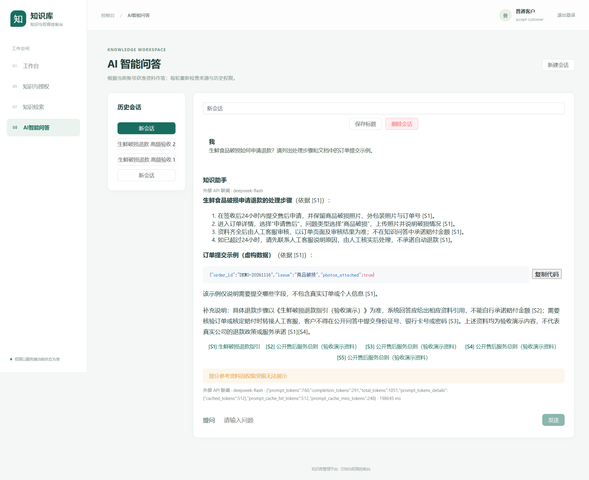
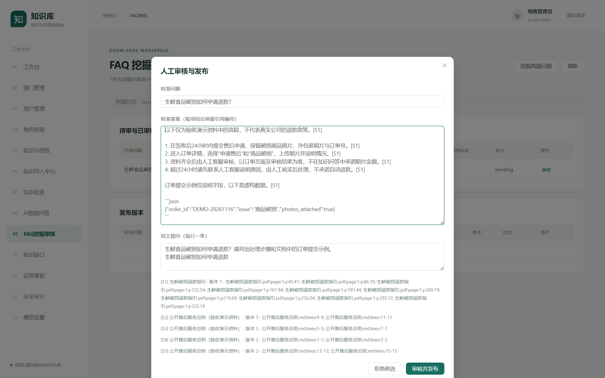
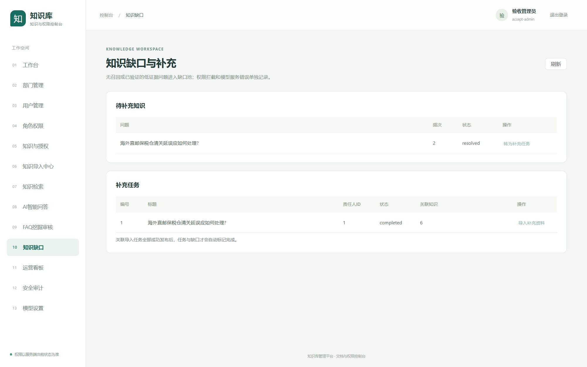
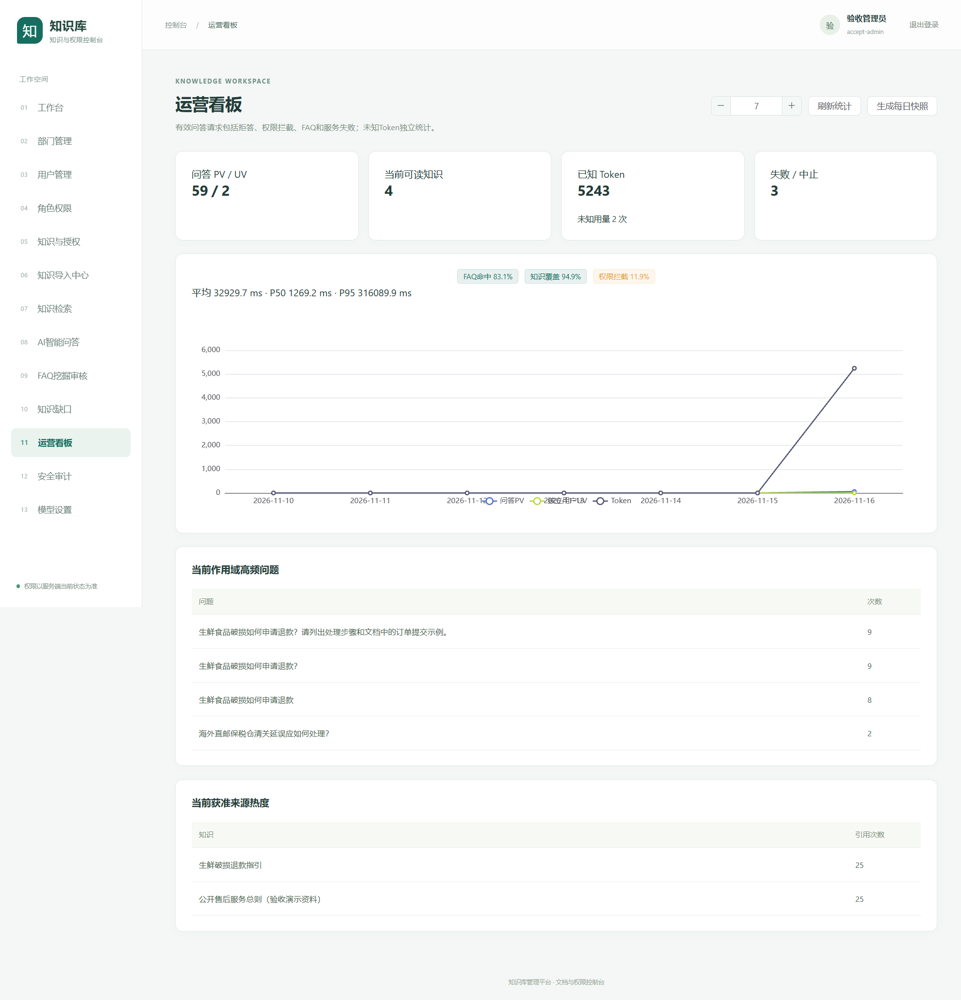

# 需求 2.9 验收截图与实际结果

2026-11-16，对照工作区《2.9 知识库管理平台》的 2.9.10 九项验收标准，使用真实页面、后台任务、DeepSeek 外部 API、BGE 检索与重排、PostgreSQL 和 Redis 完成验证。本目录保存 **24 张原始页面 PNG、5 份虚构演示文档，以及问答、缓存、审计和运营统计佐证**。

**结论：八项功能流程通过，第 6 项部分通过。看板尚未绘制响应时间趋势；FAQ 直出的中位耗时为 1.260 秒，未达到示例描述的毫秒级目标。** 五次成功模型回答耗时约 199–323 秒，不能据此认定性能达标或适合生产使用。

实现任务提交：`b77a4d97c7747f992eed6a58d8ffaa20d3cdcda9`；实现合入源项目的提交：`4a4e1b13e87343ee5ac84b8ed14775067974fea1`。本轮新增验收材料，未修改业务源码，也未推送远程。

## 九项验收矩阵

| 序号 | 文档要求 | 实际结果 | 结论与截图 |
| --- | --- | --- | --- |
| 1 | 用户登录、部门树维护、角色管理及按钮权限 | 管理员和普通用户实际登录；通过页面新增“渠道客服组”子部门与“客服知识编辑员（验收）”角色。角色仅勾选知识读取、知识维护、智能问答三项权限；普通用户创建部门返回 403，菜单随权限缩减。 | 通过：[登录](01-login.png)、[部门树](02-department-tree.png)、[角色权限](03-role-permissions.png)、[用户](04-user-management.png) |
| 2 | 界面单篇、批量导入，解析切片并检索入库 | 界面单篇导入 PDF，批量导入 DOCX、Markdown、TXT，初始 4/4 成功；补充 Markdown 成功后累计 5/5。原文已切片并发布活动版本，补充资料进入真实混合检索首位。 | 通过：[单篇](07-single-file-upload.png)、[批量](08-batch-upload.png)、[终态](09-import-results.png)、[检索](23-supplement-search.png) |
| 3 | 知识增删改查，混合配置全局、部门、角色、个人权限 | 临时知识 #5 实际新增、查询正文、异步修改标题及分类，发布版本 #6 后核对修改，再删除；再次读取返回 404。公开总则同时保存四类授权。 | 通过：[管理目录](10-knowledge-management.png)、[四维配置](11-mixed-access-controls.png)；接口佐证见 evidence.json |
| 4 | 任意一种授权命中即可访问 | 同一受限 Word 知识分别仅凭部门、角色、个人授权读取成功；全局知识对所有具有 knowledge:read 的测试用户可读。普通客户和未授权访客读取受限知识均为 403。空授权连管理员也返回 403。 | 通过：[四维配置](11-mixed-access-controls.png)；各身份状态见 evidence.json 的 acl |
| 5 | 对话强制登录态，过滤未授权知识并明确提示 | 未带认证访问会话接口返回 401。实际外部模型回答只展示获准引用，界面显示“部分参考资料因权限受限无法展示”；点击 S1 可查看固定 PDF 版本和页内位置。 | 通过：[真实问答](14-rag-answer.png)、[原文溯源](15-citation-original.png)、[审计](16-question-audits.png) |
| 6 | 正确展示 PV、UV、知识数、问题榜、知识热度、Token 及响应时间趋势 | 与 59 条原始有效问答记录对账：PV 59、UV 2、当前管理员可读知识 4、已知 Token 5243、未知用量 2 次、失败/中止 3 次。榜单及延时分位数已核对。页面绘制 PV/UV/Token 曲线，响应时间只有平均值/P50/P95，尚无时间趋势曲线。 | **部分通过**：[运营看板](24-operations-dashboard.png)、metrics.json、qa-audit-snapshot.json |
| 7 | 历史对话挖掘高频 FAQ，管理员审核发布并使用缓存 | 真实聚类生成频次 7 的待审候选；管理员整理标准答案和同义问法后发布版本 #1。界面追加 1 次、两名用户追加 48 次请求全部 FAQ 直出、模型 Token 为 0，Redis 存在两份按身份区分的答案缓存。 | 功能通过；毫秒级目标未达：[聚类](17-faq-mining.png)、[审核](18-faq-human-review.png)、[发布](19-faq-published.png)、[FAQ 回答](20-faq-cache-answer.png) |
| 8 | 自动识别未命中问题，生成缺口并查看频次 | 空库两次清关问题均真实拒答且不调用模型，缺口频次自动累计为 2。页面转补充任务并导入说明，任务 completed、缺口 resolved；普通客户可读新资料并检索到首位结果。 | 通过：[拒答](05-empty-knowledge-refusal.png)、[频次](06-gap-frequency.png)、[任务](12-supplement-task.png)、[导入](21-supplement-upload.png)、[闭环](22-gap-resolved.png)、[检索](23-supplement-search.png) |
| 9 | 至少一个典型业务场景完成问答与沉淀全流程 | 完成“生鲜破损退款 FAQ 沉淀 + 海外直邮清关缺口补足”。五次成功模型回答，加 49 次 FAQ，累计 54 次成功退款回答，覆盖两名用户。清关资料完成发布、缺口关闭及后续检索。 | 功能流程通过；演示采用当前五次聚类阈值，性能限制见下文。截图 14–23 |

## 实际流程与数据口径

测试基础身份由独立验收数据库准备。授权通过真实接口配置，并在实际管理页面复核保存。部门和角色维护、单篇与批量上传、FAQ 审核发布、补充任务创建及关联导入均从页面执行；问答与缓存样本走真实 HTTP/SSE 服务，没有替换模型回答、伪造后台终态或填入统计数字。

1. 无知识时，普通客户两次询问“海外直邮保税仓清关延误应如何处理”，得到真实拒答，自动形成频次 2 的缺口。
2. 导入四种格式的演示资料，完成默认拒绝和全局/部门/角色/个人授权核验。
3. 生鲜退款问题调用 `external_api / deepseek-flash`，保留流式输出、真实 Token、持久化回答、原文版本与引用。Markdown 及 JSON 代码高亮正常，实际点击复制后核对剪贴板内容与示例一致，会话标题已保存到历史列表。
4. 使用系统当前“七天内同簇至少五次”的规则挖掘，生成频次 7、相似度 1.0 的候选。这里的相似度是聚类结果，不是回答正确概率。
5. 管理员依据 PDF 原文整理标准应答，保留引用编号，加入两条同义问法后发布不可变版本 #1。
6. 页面一次 FAQ 提问及两名用户三种问法的 48 次追加请求全部直出，未调用生成模型。答案与已发布标准答案的 SHA-256 一致，逐例持久化内容一致。
7. 将清关缺口转为任务，关联上传补充说明。任务完成后自动关闭缺口；新知识 #6、活动版本 #7 的片段 #12 成为清关查询首位结果，重排分数约 0.994662。该分数不是置信概率。
8. 对账运营统计、作用域问题榜、知识热度和七日数据。所有样本发生于本日，其余日期无样本，没有改写时间戳制造历史趋势。

候选频次 7 包含 **5 次已完成问答与 2 次已有检索证据的取消请求**；另有 1 次检索前取消，没有进入候选。这三次取消均保留在原始审计和失败计数中，未当作成功回答。两次已调用模型的取消请求没有供应商 usage，展示为未知用量，未当作零 Token。

典型场景采用实现中的五次阈值，并非先生成超过 50 次模型回答再发布 FAQ。累计 54 次成功退款回答包含发布后的 49 次 FAQ；这个区别保留在验收结论中。

全局统计包括接受的拒答、取消与完成请求，因此 PV 为 59，FAQ 命中率为 49/59，即约 83.1%。文本榜单按当前管理员的直属部门作用域和来源权限进一步过滤；曾出现受限候选的问题不进入榜单。因此榜单次数与全局 PV、全体 FAQ 次数并不相同。知识覆盖率表示存在召回来源，不表示回答正确率。

## 已确认的问题与性能边界

| 项目 | 本轮实测 | 判断 |
| --- | --- | --- |
| 响应时间趋势 | API 提供每日 latency_ms；页面只有延时汇总，没有绘制相应时间趋势 | 第 6 项未完全达标 |
| 成功模型回答 | 5 次，约 198.645–322.963 秒 | 响应明显偏慢 |
| FAQ 首次界面直出 | 1203 ms，模型 Token 0 | 功能成立，非毫秒级目标 |
| 48 次 FAQ 平台耗时 | 最小 957.257 ms；中位 1259.668 ms；平均 1269.591 ms；P95 1508.370 ms；最大 1648.526 ms | 直出加速成立，未达到示例的毫秒级目标 |
| 管理接口 | 模型生成期间部分请求响应较慢；部分 5/10 秒限时取证请求超时，页面最终可载入 | 交互性能限制保留 |
| 检索校准 | 外部 API 模式显示“检索未校准” | 不宣称独立校准或生产质量达标 |

FAQ 耗时取服务端 usage.latency_ms，不包含登录、创建会话、读取持久化历史等取证请求。Redis 缓存仍逐请求验证身份及所有来源权限，不能用缓存绕过鉴权。此轮不包含长期负载、多日实流量、旧 DOC 转换或生产级效果验收。

## 关键页面

### 真实外部模型回答与受限资料提示

### FAQ 人工审核

### 知识缺口补足闭环

### 实际运营统计与可见的趋势缺项

## 全部截图

| 编号 | 页面 | 文件 |
| --- | --- | --- |
| 01 | 登录入口 | [01-login.png](01-login.png) |
| 02 | 部门树维护 | [02-department-tree.png](02-department-tree.png) |
| 03 | 角色及按钮权限 | [03-role-permissions.png](03-role-permissions.png) |
| 04 | 用户和部门角色分配 | [04-user-management.png](04-user-management.png) |
| 05 | 空库真实拒答 | [05-empty-knowledge-refusal.png](05-empty-knowledge-refusal.png) |
| 06 | 知识缺口频次 | [06-gap-frequency.png](06-gap-frequency.png) |
| 07 | 单文件 PDF 上传 | [07-single-file-upload.png](07-single-file-upload.png) |
| 08 | Word/Markdown/TXT 批量上传 | [08-batch-upload.png](08-batch-upload.png) |
| 09 | 导入成功终态 | [09-import-results.png](09-import-results.png) |
| 10 | 知识管理目录 | [10-knowledge-management.png](10-knowledge-management.png) |
| 11 | 四维混合授权 | [11-mixed-access-controls.png](11-mixed-access-controls.png) |
| 12 | 缺口转补充任务 | [12-supplement-task.png](12-supplement-task.png) |
| 13 | 外部模型设置 | [13-model-settings.png](13-model-settings.png) |
| 14 | 真实退款回答 | [14-rag-answer.png](14-rag-answer.png) |
| 15 | 固定版本原文溯源 | [15-citation-original.png](15-citation-original.png) |
| 16 | 独立问答审计 | [16-question-audits.png](16-question-audits.png) |
| 17 | FAQ 挖掘成功 | [17-faq-mining.png](17-faq-mining.png) |
| 18 | FAQ 人工审核 | [18-faq-human-review.png](18-faq-human-review.png) |
| 19 | FAQ 发布版本 | [19-faq-published.png](19-faq-published.png) |
| 20 | 已发布 FAQ 直出 | [20-faq-cache-answer.png](20-faq-cache-answer.png) |
| 21 | 关联补充任务上传 | [21-supplement-upload.png](21-supplement-upload.png) |
| 22 | 缺口与任务闭环 | [22-gap-resolved.png](22-gap-resolved.png) |
| 23 | 补充文档检索首位 | [23-supplement-search.png](23-supplement-search.png) |
| 24 | 实际运营看板 | [24-operations-dashboard.png](24-operations-dashboard.png) |

## 佐证和演示文档

- [evidence.json](evidence.json)：逐项验证结果、权限状态、取消记录、FAQ 发布、补充闭环及限制。
- [real-model-questions.json](real-model-questions.json)：四次追加的成功模型问答、流与持久化一致性、原文和 Token；首次成功界面问答记录在 evidence.json。
- [faq-cache-requests.json](faq-cache-requests.json)：两名用户、三种问法、48 次 FAQ 请求和两份 Redis 缓存快照；界面首次 FAQ 请求另计。
- [qa-audit-snapshot.json](qa-audit-snapshot.json)：59 条真实问答记录，保留状态、权限过滤、固定来源编号、用量和延时。
- [metrics.json](metrics.json)：七日统计、榜单和分位数的 API 原始值；已与上述审计独立对账。
- [sample-documents](sample-documents/)：PDF、DOCX、Markdown、TXT 和清关补充说明，均明确标注为虚构验收资料。

截图使用独立验收数据库、Redis DB2、API 8018 与前端 5178。截图可见虚构测试用户名，但登录密码、访问令牌及模型密钥不包含在本目录；没有提交真实订单、个人信息、.env、模型权重或运行数据库。本轮未改业务源码，因此未重复运行代码测试，实际浏览器、后台任务、SSE、持久化和数据对账结果作为本轮验证依据。
